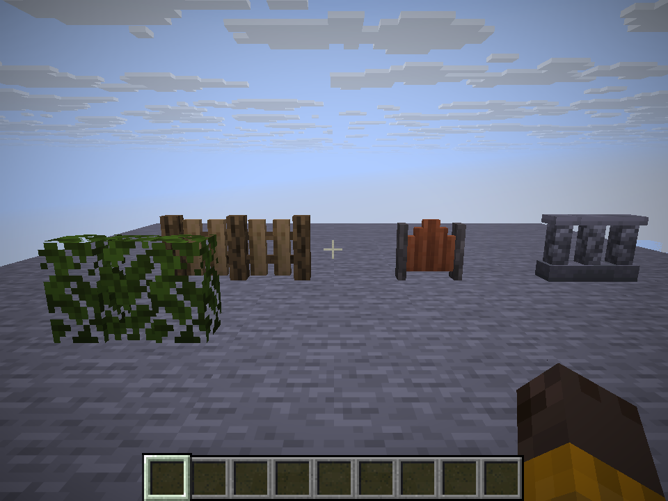
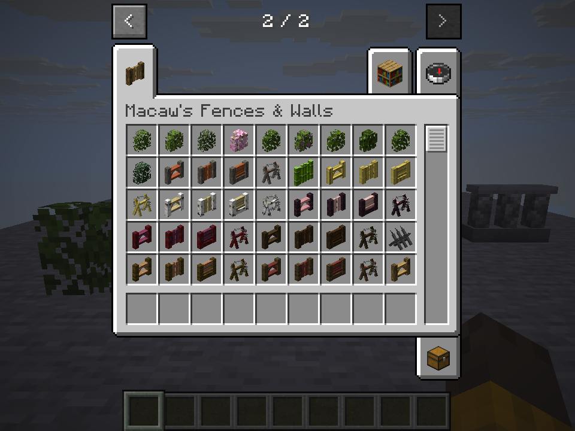

# Macaw's Fences and Walls for Horizon

A Horizon version of [Macaw's Fences and Walls](https://github.com/sketchmacaw/Fences) by
Sketch Macaw and Peachy Macaw. MIT.

It adds **150 blocks** — hedges, fences, gates and walls — in eleven woods and a range of
stone finishes. They have their own models, textures, names, recipes, drops and creative tab.





## What works

- All 150 blocks, placed, connected and drawn in game.
- Fences and walls join their neighbours, gates face the way you place them, and fences
  can be waterlogged.
- 192 recipes (150 crafting, 42 stonecutting) and 150 loot tables; crafting and drops
  checked in game.
- Stone sets need a pickaxe, hedges are as soft as leaves, and wooden fences burn in a
  furnace.
- The creative tab lists all 150 blocks.

## What doesn't work yet

- **The 11 wired fences don't hurt you.** In the original, walking through one deals 2
  damage. Hurting entities needs code, not data, so it can't be added by this file: it
  would take a separate native mod (a small Rust mod built into the game). The blocks
  themselves are all here, so a native mod could add just the damage.

That is the only known gap.

## Install

Put `mcwfences.hmod` in the `horizon-mods` folder of your game folder (the one with
`options.txt`), then turn it on in Options > Mods.

## Build

```sh
cargo install --git https://github.com/horizon-rust/horizon cargo-horizon-mod
cd content && cargo horizon-mod build
```

The file is written to `content/target/horizon-mod/mcwfences.hmod`.

## Credits and licence

Original mod: [Macaw's Fences and Walls](https://github.com/sketchmacaw/Fences) by Sketch
Macaw and Peachy Macaw. Horizon port: PlexTDM. Licence: MIT — see [LICENSE](LICENSE); the
original notices are preserved in [LICENSE-NOTICE.md](LICENSE-NOTICE.md).
